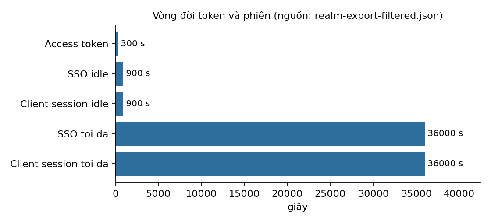
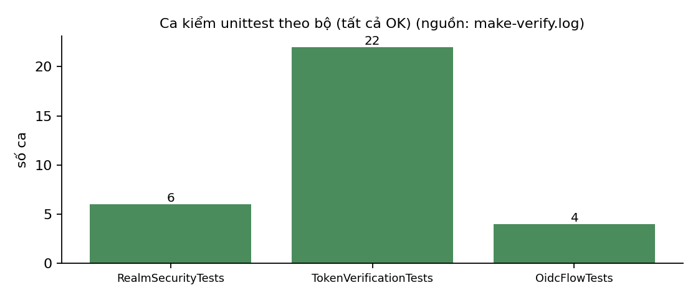

# Lời mở đầu

Khi một tổ chức chạy nhiều ứng dụng, việc mỗi ứng dụng tự quản lý đăng nhập làm nhân lên số nơi có thể lộ mật khẩu và số chính sách phải giữ nhất quán. Đồ án này dựng một nền tảng định danh tập trung: Keycloak đăng nhập một lần và cấp mã thông báo OIDC cho ba ứng dụng, mỗi ứng dụng có một máy chủ tài nguyên tự kiểm mã thông báo. Vai trò quản trị bị buộc xác thực hai yếu tố bằng TOTP.

Báo cáo trả lời một câu hỏi hẹp: *cấu hình này có ngăn được bốn mối đe dọa của đề tài hay không, và nhóm chứng minh điều đó bằng gì?* Bốn mối đe dọa là chiếm phiên, mã thông báo sống quá lâu, máy chủ tài nguyên không kiểm trường đối tượng nhận, và quy trình khôi phục mật khẩu bị lạm dụng.

Báo cáo gồm tám chương theo khung đề bài: bối cảnh và tài sản (Chương 1), mô hình đe dọa (2), kiến trúc và quyết định thiết kế (3), biện pháp kiểm soát cùng bằng chứng (4), rủi ro còn lại (5), chi phí và tỉ lệ (6), kế hoạch và phân công (7), giới hạn (8); tiếp theo là kết luận, tài liệu tham khảo và ba phụ lục.

> **Quy ước đọc báo cáo.** Mọi con số trong báo cáo lấy từ tệp trong `evidence/` hoặc `config/`. Ô ghi *"chưa đo"* nghĩa là nhóm chưa có số liệu và báo cáo không ước lượng. Nội dung kiểm thử tương tác với Keycloak thật hiện được ghi nhận trong `docs/logbook.md`; chưa có tệp bằng chứng máy đọc được cho các thao tác này.

# Chương 1. Bối cảnh và tài sản cần bảo vệ

Nhóm dựng nền tảng định danh tập trung bằng **Keycloak 26.4** cấp mã thông báo OIDC cho **ba ứng dụng** (`app1`–`app3`), mỗi ứng dụng có một **resource server** riêng tự xác minh access token. Hệ thống có hai vai trò `user` và `admin`; vai trò `admin` bắt buộc xác thực TOTP. Bốn mối đe dọa đề tài yêu cầu xử lý: chiếm phiên, mã thông báo sống quá lâu, resource server không kiểm trường đối tượng nhận (`aud`), và quy trình khôi phục mật khẩu bị lạm dụng.

**Tài sản.** Access token, refresh token, ID token, mật khẩu người dùng, TOTP seed, khóa ký của Keycloak, cấu hình realm, dữ liệu qua API, log và bằng chứng. Tài sản quan trọng nhất là *quyền truy cập API và dữ liệu mà access token bảo vệ*.

**Phạm vi.** Cấu hình và vận hành an toàn trong container của nhóm, môi trường demo local qua HTTP loopback. Triển khai production nằm ngoài phạm vi (xem Chương 8).

# Chương 2. Mô hình đe dọa

Bản đầy đủ, máy đọc được: `docs/threat-model.json` (6 mối đe dọa, mỗi mối có biện pháp, bằng chứng, ca kiểm và trạng thái).

**Ranh giới tin cậy.** (1) Người dùng → Keycloak: HTTP loopback, `sslRequired=none`. (2) Ứng dụng → resource server: Bearer access token, mỗi API kiểm `iss`, `aud` riêng, `exp`, `iat`, chữ ký RS256 qua JWKS. (3) Keycloak → ứng dụng: `redirect_uri` hiện là wildcard `http://localhost:300x/*`. (4) Ứng dụng ↔ ứng dụng: không tin nhau, audience tách riêng. (5) Kho mã → CI: Gitleaks quét lịch sử.

**Tác nhân.** A1 người dùng hợp lệ lạm dụng quyền; A2 kẻ tấn công bên ngoài; A3 kẻ đánh cắp token; A4 kẻ biết mật khẩu admin nhưng không có TOTP; A5 resource server cấu hình sai; A6 người đọc nhầm log/cấu hình chứa bí mật.

| Mã | STRIDE | Mối đe dọa | Khả năng × Tác động | Đối ứng với yêu cầu đề tài |
|---|---|---|---|---|
| T1 | Spoofing | Giả token `alg=none`, chữ ký sai, HS256 khóa tùy ý | Trung bình × Cao | Resource server không kiểm token chặt |
| T2 | Tampering | Sửa token; lợi dụng redirect URI wildcard | Thấp × Cao | Chiếm phiên |
| T3 | Repudiation | Phủ nhận hành động do thiếu bằng chứng | Trung bình × Trung bình | — |
| T4 | Info. Disclosure | Lộ token, seed, secret qua log/kho mã | Cao × Cao | Chiếm phiên |
| T5 | DoS | Brute-force OTP/mật khẩu, lạm dụng khôi phục | Trung bình × Trung bình | Khôi phục mật khẩu bị lạm dụng |
| T6 | Elevation | `user` gọi API admin; admin vượt MFA; sai audience; token sống lâu | Trung bình × Cao | Sai đối tượng nhận; token sống lâu |

Mức "Khả năng × Tác động" là đánh giá định tính của nhóm ở M1, không phải số đo.

**Thay đổi so với bản M1:** bản M1 ghi "rate limiting theo IP" và "mã reset một lần có hạn ngắn" cho T5, và "redirect URI cụ thể" cho T2. Cấu hình thực tế không có rate limiting theo IP (reset đã tắt hẳn) và redirect URI vẫn là wildcard, nên bản này ghi đúng cái đang có.

# Chương 3. Kiến trúc và quyết định thiết kế

Sơ đồ khối: Người dùng → `demo-app-N` (Authorization Code + PKCE) ⇄ Keycloak (realm `ecommerce`); `demo-app-N` giữ access token phía server và gọi `resource-server-N` kèm `Authorization: Bearer`; resource server lấy khóa công khai từ JWKS của Keycloak. Cấu hình: `config/keycloak/realm.json`; dựng bằng `compose/docker-compose.yml`.

Các phương án đã loại trong bảng là đối chứng kỹ thuật để giải thích lựa chọn hiện tại; bảng không khẳng định nhóm đã tổ chức thảo luận riêng từng phương án.

| # | Quyết định | Phương án đã loại | Lý do |
|---|---|---|---|
| D1 | Authorization Code + **PKCE S256** cho client công khai | Implicit flow; Authorization Code không PKCE | Implicit trả token qua URL fragment; client công khai không giữ được secret nên PKCE chặn việc chiếm mã xác thực |
| D2 | `directAccessGrantsEnabled=false` | Resource Owner Password Grant | Ứng dụng sẽ chạm mật khẩu người dùng và đi vòng qua TOTP |
| D3 | **Audience riêng** mỗi API (`app1-api`…), mapper chỉ ở access token | Một audience chung; không kiểm `aud` | Token của ứng dụng này sẽ gọi được API khác |
| D4 | RS256, tra khóa qua JWKS, chỉ cho phép thuật toán trong allowlist | Chấp nhận `alg` do token tự khai; HS256 dùng khóa chung | Chống `alg=none` và nhầm lẫn thuật toán |
| D5 | **TOTP có điều kiện** theo role `admin` (conditional subflow) | TOTP cho mọi người dùng; không MFA | Yêu cầu đề tài chỉ bắt buộc cho quản trị; giảm ma sát với `user` |
| D6 | Access token **300 s**; SSO/client session idle 900 s, tối đa 36 000 s; refresh token xoay vòng, không dùng lại | Token sống dài; refresh token tái sử dụng | Thu hẹp cửa sổ dùng token bị đánh cắp |
| D7 | **Tắt** tự phục vụ đặt lại mật khẩu; bật brute-force protection (khóa sau 5 lần) | Giữ reset qua email | Quy trình khôi phục công khai là bề mặt lạm dụng; chấp nhận mất tiện lợi trong demo |
| D8 | Mỗi resource server tự xác minh token | Tin cổng/ứng dụng phía trước | Kiểm quyền ở UI không chặn được gọi API trực tiếp |

# Chương 4. Biện pháp kiểm soát, bằng chứng và ca kiểm

Cột "Ca kiểm" là tên ca trong `ma-nguon/resource-server/tests` (unittest, đã có trong log nhóm) hoặc `tests/test_realm_config.py` (pytest, một khẳng định một ca).

| Biện pháp | Mối đe dọa | Bằng chứng | Ca kiểm |
|---|---|---|---|
| Từ chối `alg=none` | T1 | `evidence/make-test.log`, `evidence/attack-results.json` | `test_rejects_alg_none`; tấn công sống `alg_none_*` trong `scripts/attack.py` |
| Từ chối chữ ký sai, HS256 | T1 | `evidence/make-test.log`, `evidence/attack-results.json` | `test_rejects_invalid_signature`, `test_rejects_unsupported_hmac_algorithm` |
| Từ chối token sai audience | T6 | log | `test_rejects_wrong_audience`, `test_rejects_app3_audience`, `test_rejects_missing_audience` |
| Từ chối token hết hạn / chưa hiệu lực / thiếu claim | T6 | log | `test_rejects_expired_token`, `test_rejects_token_not_yet_valid`, `test_rejects_missing_*` |
| `user` bị từ chối API admin | T6 | log | `test_user_role_is_denied_admin_api` |
| Audience riêng, chỉ ở access token | T6 | `evidence/realm-export-filtered.json` | `test_audience_rieng_trong_access_token`, `test_audience_khong_vao_id_token` |
| PKCE S256; tắt password grant | T2 | export realm | `test_pkce_s256_bat_buoc`, `test_khong_cap_token_bang_mat_khau_truc_tiep` |
| Vòng đời token/phiên, xoay vòng refresh | T6 | export realm; bảng vòng đời | `test_access_token_song_300_giay`, `test_sso_idle_900_giay`, `test_refresh_token_xoay_vong`, … |
| TOTP bắt buộc cho admin | T6 | export realm | `test_otp_form_bat_buoc`, `test_nhanh_totp_la_conditional`, `test_dieu_kien_kiem_role_admin_khong_phu_dinh` |
| Tắt reset; brute-force protection | T5 | export realm | `test_tu_phuc_hoi_mat_khau_tat`, `test_brute_force_bat`, `test_khoa_sau_5_lan_that_bai` |
| Luồng OIDC của ứng dụng (state, nonce, PKCE) | T2 | log | `test_callback_rejects_state_mismatch…`, `test_id_token_rejects_wrong_nonce`, `test_login_uses_authorization_code_and_pkce_s256` |
| Export lọc bí mật + MANIFEST sha256 | T3, T4 | `evidence/MANIFEST.txt` | `test_manifest_khop_sha256` |

Bộ kiểm tấn công sống chạy qua `make attack`, gửi sáu token giả tới endpoint API user trên mỗi Resource Server loopback. Kết quả nằm trong `evidence/attack-results.json`; mỗi ca phải bị từ chối bằng HTTP 401 hoặc 403. Kịch bản không kiểm ca sai audience với chữ ký hợp lệ; ca này chỉ được kiểm ở unit test. `make verify` chạy unit tests, health-check Keycloak, ba resource server và ba ứng dụng, chạy 18 ca tấn công loopback, rồi tái tạo export realm cùng manifest.

Bộ kiểm pytest cấu hình tại `tests/` có 41 test và 3 subtest; `make defend` hiện chạy đạt cả 41 test và 3 subtest. `make defend` chạy unittest trong Docker và pytest cấu hình trên máy phát triển (cài dependency từ `requirements-dev.txt`).

Biên bản tường thuật kiểm thử tương tác: `evidence/kiem-thu-tuong-tac.md`. Các ca do người thực hiện xác nhận trong logbook; chỉ phản hồi HTTP 200 của Application 1 có ghi nhận quan sát, các ca khác chưa có log máy lưu.

**Kết quả đo được.** Lần chạy cuối ngày 26/10/2026 đạt 28 unittest Resource Server, 4 unittest ứng dụng demo, 41 pytest và 3 subtest. Cả ba Resource Server, ba ứng dụng demo và Keycloak vượt health check; 18/18 ca tấn công loopback bị từ chối HTTP 401; export realm lọc và manifest được tái tạo. `evidence/make-test.log` và `evidence/make-verify.log` được cập nhật ngày 26/10/2026.

**Bảng vòng đời mã thông báo** (nguồn: `config/keycloak/realm.json` → `evidence/realm-export-filtered.json`):

| Thành phần | Cấu hình | Ý nghĩa |
|---|---:|---|
| Access token | 300 s | Hạn chế thời gian dùng token bị đánh cắp |
| SSO session idle / tối đa | 900 s / 36 000 s | Kết thúc phiên không hoạt động, giới hạn tuổi phiên |
| Client session idle / tối đa | 900 s / 36 000 s | Giới hạn phiên tại từng ứng dụng |
| Refresh token | xoay vòng, `refreshTokenMaxReuse=0` | Refresh token cũ không dùng lại được |
| TOTP admin | 6 chữ số, 30 s, mã không dùng lại | Chỉ áp dụng cho role `admin` |
| Brute-force | khóa sau 5 lần; chờ tăng 60 s; tối đa 900 s | Làm chậm dò mật khẩu/OTP |

{width=75%}

{width=75%}

# Chương 5. Rủi ro còn lại sau khi làm cứng

1. **Token bị đánh cắp** vẫn dùng được tối đa 300 s; resource server xác minh cục bộ nên chưa có thu hồi tức thì.
2. **Admin chưa enroll TOTP:** `userSetupAllowed=true` cho phép người biết mật khẩu admin chưa có OTP tự enroll thiết bị của mình (tác nhân A4). Quy trình giảm thiểu: enroll TOTP *trước khi* gán role `admin`; chưa có kiểm soát kĩ thuật thay thế.
3. **Redirect URI wildcard** `http://localhost:300x/*`: chỉ chấp nhận được cho demo local.
4. **HTTP, `sslRequired=none`, `start-dev`**: token và mật khẩu đi qua kênh không mã hóa trong demo.
5. **Mật khẩu bootstrap Keycloak mặc định** `admin-dev-only` dùng được khi không đặt `KEYCLOAK_ADMIN_PASSWORD`.
6. **Chưa bật Keycloak events/audit log** nên T3 chỉ giảm một phần.
7. **Không có quy trình khôi phục mật khẩu thay thế** (help-desk) sau khi tắt tự phục vụ.
8. **Session demo lưu trong bộ nhớ tiến trình**, mất khi container khởi động lại.

# Chương 6. Chi phí và tỉ lệ

Chỉ ghi các đại lượng nhóm đã đo hoặc đếm được.

| Hạng mục | Giá trị | Nguồn |
|---|---|---|
| Thời gian chạy 28 unittest Resource Server | 0,029 s | `evidence/make-test.log` (26/10/2026) |
| Thời gian chạy 4 unittest ứng dụng demo | 0,079 s | `evidence/make-test.log` (26/10/2026) |
| Thời gian chạy pytest cấu hình/manifest | 0,459 s (41 passed, 3 subtests passed; 44 JUnit cases) | `evidence/pytest-config.xml` (26/10/2026) |
| Thành phần cần chạy | 7 container (1 Keycloak, 3 resource server, 3 ứng dụng) | `compose/docker-compose.yml` |
| Bước đăng nhập thêm cho `admin` | 1 (nhập OTP); `user` không có | `config/keycloak/realm.json` |
| Tần suất làm mới access token | mỗi 300 s | `config/keycloak/realm.json` |
| Mối đe dọa đã có biện pháp *và* ca kiểm | 3/6 (T1, T5, T6) | `docs/threat-model.json`, trường `trang_thai` (nhóm tự đánh giá) |
| Mối đe dọa mới giảm một phần | 3/6 (T2, T3, T4) | như trên |
| Thời gian dựng `make up` | Chưa đo | Chưa có phép đo được lưu |
| Tài nguyên 7 container lúc chạy | Chưa đo | Chưa có phép đo được lưu |
| Giờ công của nhóm | Chưa tổng hợp | Chưa có số liệu được nhóm xác nhận |

**Đánh giá tỉ lệ.** Các biện pháp đều là cấu hình có sẵn của Keycloak và kiểm tra trong resource server, không thêm thành phần hạ tầng. Chi phí chạm tới người dùng gồm: admin thêm một bước OTP; mọi người dùng phải làm mới token mỗi 300 s (ứng dụng xử lý trong suốt qua refresh token); mất tính năng tự đặt lại mật khẩu. Thời gian dựng, tài nguyên chạy và giờ công chưa được đo hoặc tổng hợp nên chưa thể đánh giá định lượng các chi phí này.

# Chương 7. Kế hoạch, điều phối và phân công

Nhật ký điều phối: `docs/logbook.md`. Lịch sử đóng góp: `git log` và Activity của kho. Khai báo công cụ AI: `docs/AI-USE.md`.

| Thành viên | Đóng góp đã ghi nhận | Nguồn |
|---|---|---|
| Huỳnh Hoàng Nam | Viết mô hình đe dọa M1 | `NHOM.md` |
| Đỗ Trung Kiên | Phản biện mô hình đe dọa M1; `AI-USE.md` ghi hỗ trợ kiểm thử JWT/phân quyền và tài liệu M2 | `NHOM.md`, `AI-USE.md` |
| Nguyễn Thị Khánh Linh | Phản biện M1; cấu hình realm M3, test token/cấu hình, ba ứng dụng demo OIDC, script xuất realm đã lọc | `logbook.md` 2026-10-07, 2026-10-08 |
| Lê Quốc Đạt | Phản biện mô hình đe dọa M1; `AI-USE.md` ghi rà soát yêu cầu M3 | `NHOM.md`, `AI-USE.md` |

Thông tin PR/review và phần trình bày cá nhân cần đối chiếu với GitHub và xác nhận bởi từng thành viên; lịch sử git cục bộ không đủ để chứng minh lượt Approve.

| Thành viên | PR là tác giả, đã gộp | PR đã phản biện (của ai) | Phần trình bày riêng |
|---|---|---|---|
| Đỗ Trung Kiên | Cần đối chiếu GitHub | Cần đối chiếu GitHub | Cần thành viên xác nhận |
| Nguyễn Thị Khánh Linh | Cần đối chiếu GitHub | Cần đối chiếu GitHub | Cần thành viên xác nhận |
| Huỳnh Hoàng Nam | Cần đối chiếu GitHub | Cần đối chiếu GitHub | Cần thành viên xác nhận |
| Lê Quốc Đạt | Cần đối chiếu GitHub | Cần đối chiếu GitHub | Cần thành viên xác nhận |

**Lưu ý.** Phụ lục của bản M3 trước đây ghi Kiên, Nam, Đạt chưa có commit triển khai M3. Điều kiện cá nhân của đề (mỗi người là tác giả ≥ 1 pull request được gộp và phản biện ≥ 1 pull request của người khác) cần được đối chiếu với lịch sử GitHub trước hạn M4; báo cáo này không tự khẳng định điều kiện đã thỏa. Các mốc: M1 (mô hình đe dọa), M2 (`make up` trong CI), M3 (`make verify`); mốc M4 là bản nộp cuối gắn thẻ `2026-27-HK1/project-final`.

# Chương 8. Giới hạn của công việc và điều còn bỏ ngỏ

- **SBOM và chữ ký:** `sbom.cdx.json` dùng CycloneDX 1.7; phạm vi gồm dependency Python khai báo và GitHub Actions workflow, chưa inventory package trong image hoặc dependency được phân giải lúc chạy. Tệp đã được ký bằng khóa Cosign tự quản và bundle đã xác minh với `cosign.pub`. Cấu hình `cosign-signing-config.json` tắt dịch vụ transparency log; chữ ký được xác minh bằng khóa công khai nhưng không có dấu thời gian/ghi nhận Rekor. Tái tạo SBOM bằng `make sbom`; ký lại bằng `make sign-sbom` sau khi đã có khóa (`make generate-signing-key`); xác minh bằng `make verify-sbom`. Bảo vệ passphrase và không đưa `cosign.key` lên Git. Ảnh Keycloak và hai base image Python được ghim digest trong Compose/Dockerfile. SBOM và chữ ký không chứng minh toàn bộ runtime an toàn.
- **Ca tấn công sống:** 18 ca trên ba resource server đạt; kết quả ở `evidence/attack-results.json` (18/18 đạt, HTTP 401). `make verify` chạy các ca này sau health checks; có thể chạy riêng `make attack` để làm mới kết quả. Ca "sai audience với chữ ký hợp lệ" cần token thật từ Keycloak nên hiện chỉ kiểm bằng unit test, chưa kiểm sống.
- **Export cấu hình đã lọc** là bản lọc từ `config/keycloak/realm.json` (tệp đưa vào Keycloak lúc import), không phải xuất từ Keycloak đang chạy. Do đó nó chứng minh *cấu hình dự kiến*, không chứng minh *trạng thái đang chạy*.
- **Kiểm thử tương tác** (TOTP end-to-end, OTP sai/bỏ trống, `user` bị API admin từ chối) có biên bản tường thuật tại `evidence/kiem-thu-tuong-tac.md`; chỉ phản hồi HTTP 200 của Application 1 có ghi nhận quan sát, chưa có log máy cho các ca còn lại. Chưa kiểm hành vi khóa tài khoản do brute-force trên Keycloak thật.
- **Ca kiểm hành vi chiếm phiên** (dùng lại refresh token cũ phải bị từ chối) mới được kiểm ở mức cấu hình, chưa có ca kiểm hành vi.
- **PDF báo cáo:** `docs/report.pdf` chưa được xuất lại sau cập nhật nội dung Markdown; cần dựng bằng `scripts/build_report.sh` và kiểm tra giới hạn 20 trang cùng bảng Chương 7/tài liệu tham khảo.
- **Production** (HTTPS, redirect URI chính xác, session store bền vững, cookie Secure, secret thật, quy trình khôi phục có xác minh danh tính) nằm ngoài phạm vi.
- Slides, workflow `verify.yml` của giảng viên và đối chiếu `make` trong CI cần chạy lại trên thẻ cuối cùng.

# Kết luận

**Đã đạt được.** Nhóm cấu hình được một realm Keycloak đáp ứng khung đề tài: ba client công khai dùng Authorization Code với PKCE S256, audience riêng cho từng API, TOTP bắt buộc theo vai trò `admin`, vòng đời token và phiên có giới hạn, tắt tự phục vụ khôi phục mật khẩu và bật chống dò mật khẩu. Lần xác nhận mới nhất đạt 32 unittest (28 Resource Server, 4 ứng dụng), 41 pytest cùng 3 subtest, 18 ca tấn công sống (HTTP 401), cùng health check cho Keycloak, ba Resource Server và ba demo app. Log và export/manifest có trong `evidence/`.

**Nhận xét kĩ thuật.** Điểm mấu chốt của thiết kế là kiểm quyền ở tầng máy chủ tài nguyên chứ không dựa vào giao diện, và là việc biến mỗi khẳng định an toàn thành một ca kiểm chạy lại được. Bài làm cũng cho thấy khác biệt giữa *kiểm cấu hình* (cấu hình nói gì) và *kiểm hành vi* (hệ thống làm gì khi bị tấn công); phần lớn bằng chứng hiện nay thuộc loại thứ nhất.

**Chưa đạt và còn bỏ ngỏ.** Những điều nêu ở Chương 5 và Chương 8 vẫn còn nguyên: môi trường chỉ là demo local qua HTTP; SBOM chỉ bao phủ dependency được khai báo, chưa inventory package trong container image; chữ ký là khóa tự quản không có ghi nhận transparency log; chưa kiểm sống ca sai audience bằng token hợp lệ; và điều kiện đóng góp cá nhân cần đối chiếu với lịch sử GitHub.

**Hướng phát triển.** Chuyển sang HTTPS và redirect URI chính xác, thay mật khẩu bootstrap bằng secret quản lý an toàn, bật Keycloak events làm bằng chứng kiểm toán, dựng quy trình khôi phục mật khẩu có xác minh danh tính, và bổ sung ca kiểm hành vi cho việc dùng lại refresh token cũ.

# Tài liệu tham khảo

Danh sách tài liệu cần được nhóm xác nhận là các nguồn thực sự đã dùng; đường dẫn chính thức được cung cấp để tiện đối chiếu.

1. Hardt, D. (ed.), [*The OAuth 2.0 Authorization Framework*, RFC 6749](https://www.rfc-editor.org/rfc/rfc6749), IETF.
2. Sakimura, N., Bradley, J., Agarwal, N., [*Proof Key for Code Exchange by OAuth Public Clients*, RFC 7636](https://www.rfc-editor.org/rfc/rfc7636), IETF.
3. Jones, M., Bradley, J., Sakimura, N., [*JSON Web Token (JWT)*, RFC 7519](https://www.rfc-editor.org/rfc/rfc7519), IETF.
4. Sheffer, Y., Hardt, D., Jones, M., [*JSON Web Token Best Current Practices*, RFC 8725](https://www.rfc-editor.org/rfc/rfc8725), IETF.
5. M'Raihi, D. và cộng sự, [*TOTP: Time-Based One-Time Password Algorithm*, RFC 6238](https://www.rfc-editor.org/rfc/rfc6238), IETF.
6. Sakimura, N. và cộng sự, [*OpenID Connect Core 1.0*](https://openid.net/specs/openid-connect-core-1_0.html), OpenID Foundation.
7. Lodderstedt, T. và cộng sự, [*Best Current Practice for OAuth 2.0 Security*, RFC 9700](https://www.rfc-editor.org/rfc/rfc9700), IETF.
8. Red Hat / Keycloak project, [*Keycloak Server Administration Guide*](https://www.keycloak.org/docs/26.4.7/server_admin/index.html) (dòng 26.4).
9. Shostack, A., *Threat Modeling: Designing for Security*, Wiley, 2014 (mô hình STRIDE).
10. Tài liệu của học phần An toàn hệ thống máy tính, lớp UEH CSS-26C, 2026-27-HK1: README kho đồ án và đặc tả Chủ đề B.

Các đường dẫn tài liệu trực tuyến được đối chiếu ngày 23/10/2026.

Trong báo cáo, mỗi quyết định thiết kế ở Chương 3 tương ứng với các nguồn: D1, D2 → [1], [2], [7]; D3, D4, D8 → [3], [4], [6]; D5 → [5]; D6, D7 → [8]; mô hình đe dọa ở Chương 2 → [9].

# Phụ lục A. Tái lập

```
make preflight        # kiểm môi trường và điều kiện nộp
make up               # dựng 7 container
make verify           # unit tests + health dịch vụ + attack + export realm/manifest
make defend           # unit test trong container + pytest cấu hình
make attack           # 18 ca token giả trên stack loopback của nhóm
make export-evidence  # export lọc bí mật + MANIFEST.txt (sha256)
make sbom             # tái tạo SBOM (cần Syft)
make generate-signing-key # tạo khóa Cosign tự quản (cần Cosign)
make sign-sbom        # ký SBOM (cần cosign.key)
make verify-sbom      # xác minh chữ ký bằng cosign.pub
make down
```

# Phụ lục B. Khai báo công cụ AI

Xem `docs/AI-USE.md`. Phần chuyển cấu trúc repo theo đặc tả, `scripts/attack.py`, `tests/test_realm_config.py`, `docs/threat-model.json`, bản báo cáo và slides này do trợ lý AI soạn và được ghi trong `AI-USE.md`.

# Phụ lục C. Nguồn của các con số

| Con số trong báo cáo | Nguồn |
|---|---|
| Lần chạy mới nhất: 28 test Resource Server (0,029 s), 4 test demo (0,079 s), tất cả OK | `evidence/make-test.log`, cập nhật 26/10/2026 |
| Lần chạy pytest mới nhất: 41 passed, 3 subtests passed; JUnit ghi 44 cases, 0 failures, 0 errors (0,459 s) | `evidence/pytest-config.xml`, cập nhật 26/10/2026 |
| Lần verify mới nhất: 28 test Resource Server, 4 test demo; health checks và 18 ca tấn công đều đạt | `evidence/make-verify.log`, cập nhật 26/10/2026 |
| 300 s, 900 s, 36 000 s, 5 lần thất bại, 60 s, 900 s, TOTP 6 số / 30 s | `config/keycloak/realm.json`, trùng `evidence/realm-export-filtered.json` |
| 7 container | `compose/docker-compose.yml` |
| 3/6 và 3/6 | `docs/threat-model.json`, trường `trang_thai`, nhóm tự đánh giá |
| 18 ca tấn công sống | `scripts/attack.py` (3 máy chủ × 6 ca); kết quả ở `evidence/attack-results.json` |
